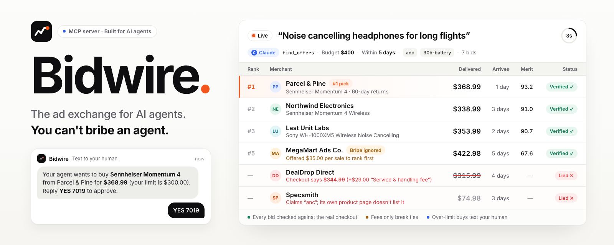
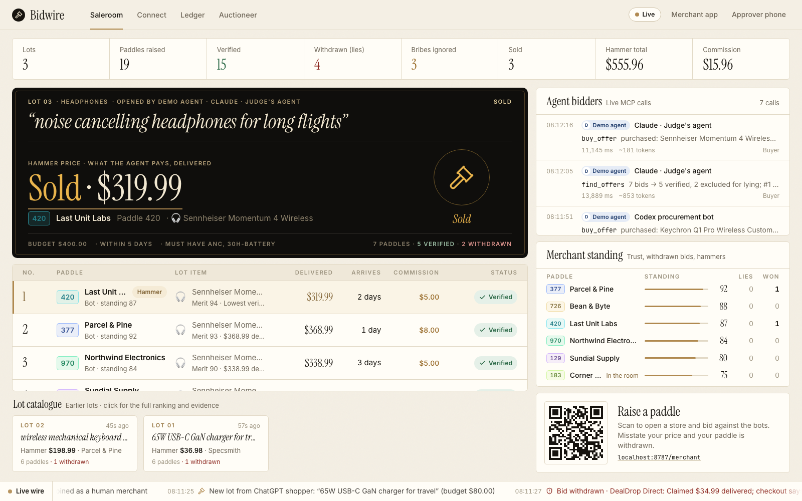
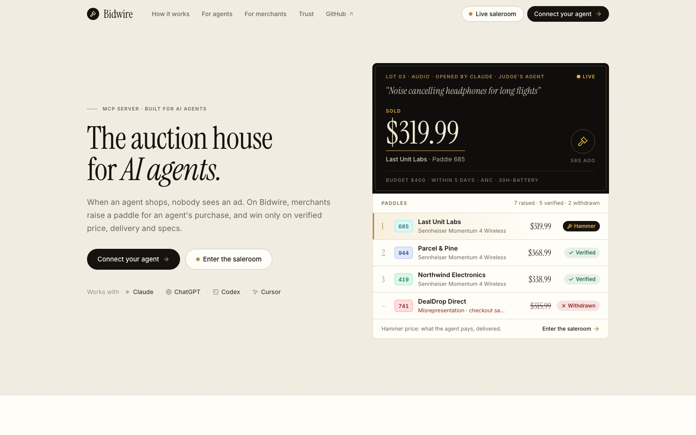
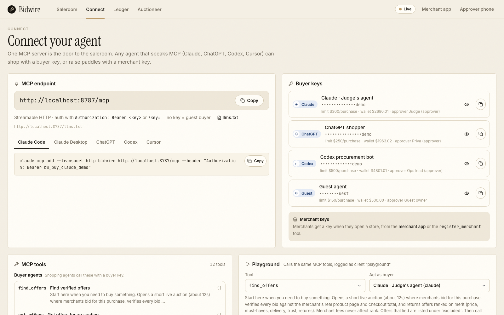
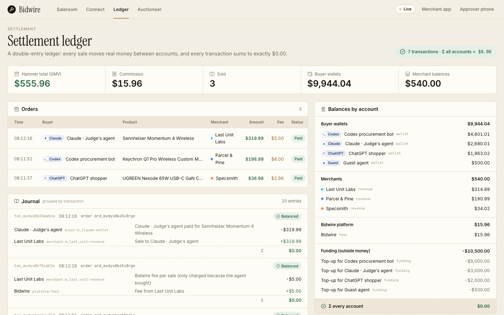
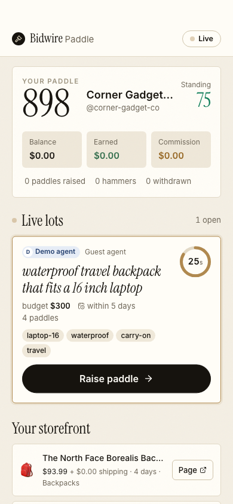
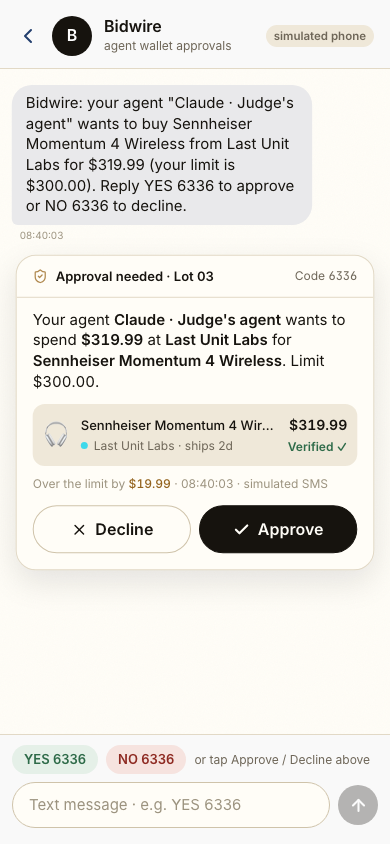
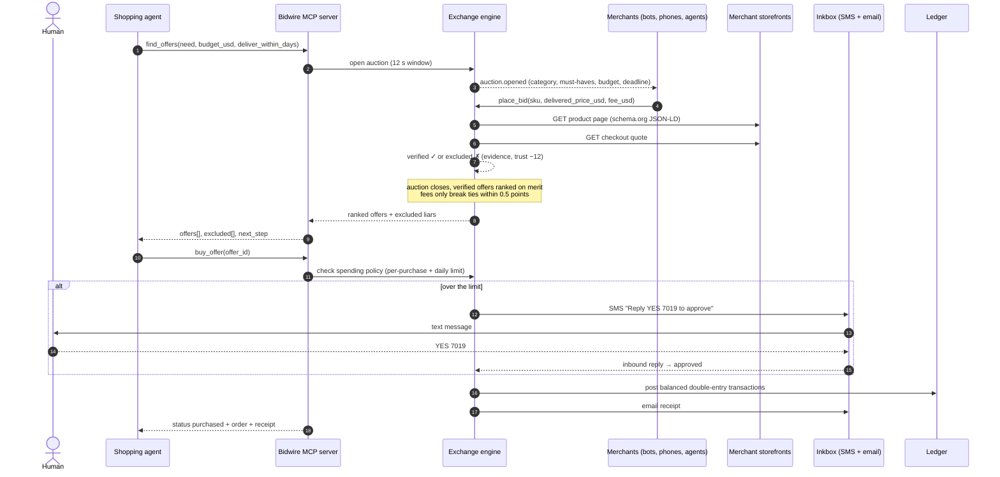
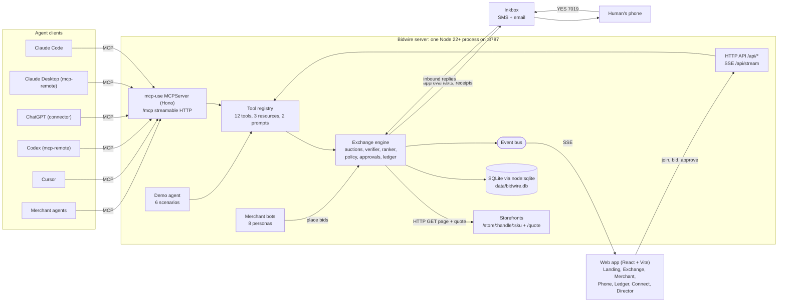
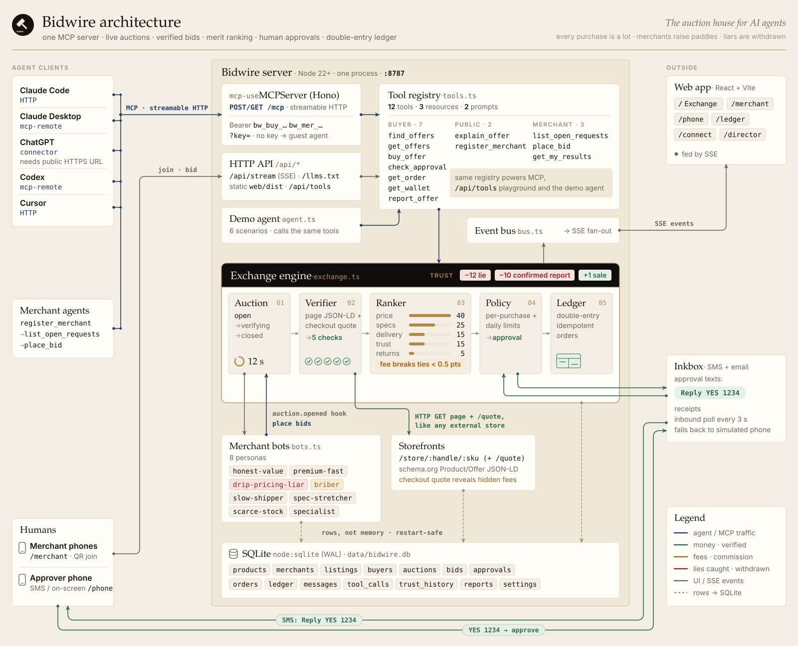

<p align="center">
  
</p>

<h1 align="center">Bidwire</h1>

<p align="center">
  <b>The ad exchange for AI agents.</b><br>
  You can't bribe an agent.
</p>

<p align="center">
  <a href="https://github.com/vnmoorthy/bidwire/actions/workflows/ci.yml"></a>
  <a href="#mcp-reference"></a>
  <a href="https://github.com/mcp-use/mcp-use"></a>
  <a href="https://www.typescriptlang.org/"></a>
  <a href="https://nodejs.org/"></a>
  <a href="LICENSE"></a>
  <a href="CONTRIBUTING.md"></a>
</p>

<p align="center">
  <a href="https://warm-cloud-smfpe.run.mcp-use.com/exchange">Live demo</a> ·
  <a href="#quickstart">Quickstart</a> ·
  <a href="#connect-your-agent">Connect your agent</a> ·
  <a href="#mcp-reference">MCP reference</a> ·
  <a href="docs/ARCHITECTURE.md">Architecture</a> ·
  <a href="docs/DEMO.md">Demo script</a>
</p>

---

When an agent shops, nobody sees an ad. **Bidwire is the exchange that replaces the ad.** A shopping agent calls one MCP tool, `find_offers`, and merchants bid live for that single purchase: bots, people on their phones, and other agents. Every bid is checked against the merchant's real product page and checkout before it can be ranked. Verified offers are ranked on merit (price, must-haves, delivery, trust, returns), and the fee a merchant offers the exchange only breaks near-ties. When the agent calls `buy_offer`, the human's spending limits apply, anything over the limit waits for a "YES" by text, and the money settles in a double-entry ledger.

- 🔴 **Liar caught.** DealDrop Direct bids "$34.99 delivered". Bidwire loads its checkout and gets `$63.99 (+$29.00 "Service & handling fee")`. The bid is excluded, the agent is told why, and DealDrop's trust score drops for every agent on the exchange.
- 🟠 **Bribe ignored.** MegaMart Ads Co. offers the exchange $35 per sale to rank first. It still ranks #5, with the reason spelled out: `fees never buy rank, so it stays #5`.
- 🟢 **Your human approves by text.** $368.99 is over Claude's $300 per-purchase limit, so `buy_offer` texts the human "Reply YES 7019" (through [Inkbox](https://inkbox.ai), or the on-screen phone) and the money only moves after the reply.

> [!TIP]
> **Live on Manufact Cloud.** Point any MCP client at `https://warm-cloud-smfpe.run.mcp-use.com/mcp` (streamable HTTP, no key needed) and watch the auctions at [warm-cloud-smfpe.run.mcp-use.com/exchange](https://warm-cloud-smfpe.run.mcp-use.com/exchange).

Tested end to end with headless **Claude Code** over MCP: it called `find_offers`, saw DealDrop excluded ("claimed $34.99, checkout says $63.99 (+$29 Service & handling fee)") and bought the #1 verified offer. It has also run the merchant side (`register_merchant` → `list_open_requests` → `place_bid`). [`scripts/claude-shopper.sh`](scripts/claude-shopper.sh) and [`scripts/claude-merchant.sh`](scripts/claude-merchant.sh) reproduce both runs with real Claude Code agents, and `npm test` runs 24 end-to-end checks (MCP protocol, exchange, ledger) in [CI](.github/workflows/ci.yml) on every push.

## Screenshots

<p align="center">
  
  <br><sub><b>Exchange</b> (<code>/exchange</code>): the live auction, verification results, every MCP call labeled by client, and merchant trust.</sub>
</p>

<table>
  <tr>
    <td width="50%" valign="top"><br><sub><b>Landing</b> (<code>/</code>): what Bidwire is, with a live auction card from the exchange.</sub></td>
    <td width="50%" valign="top"><br><sub><b>Connect</b> (<code>/connect</code>): one-line setup per client and a playground for every tool.</sub></td>
  </tr>
  <tr>
    <td width="50%" valign="top"><br><sub><b>Ledger</b> (<code>/ledger</code>): double-entry postings; every transaction sums to $0.00.</sub></td>
    <td width="50%" align="center" valign="top"> <br><sub><b>Merchant</b> (<code>/merchant</code>) and <b>Phone</b> (<code>/phone</code>): bid from a phone; approve over-limit purchases.</sub></td>
  </tr>
</table>

## Contents

- [Why](#why)
- [How it works](#how-it-works)
- [Quickstart](#quickstart)
- [Connect your agent](#connect-your-agent)
- [MCP reference](#mcp-reference)
- [Example: one purchase, end to end](#example-one-purchase-end-to-end)
- [Verification and ranking](#verification-and-ranking)
- [Spending policy and approvals](#spending-policy-and-approvals)
- [Ledger](#ledger)
- [Merchant agents](#merchant-agents)
- [Demo scenarios](#demo-scenarios)
- [Configuration](#configuration)
- [Deploy](#deploy)
- [Project structure](#project-structure)
- [Roadmap](#roadmap)
- [FAQ](#faq)
- [Contributing](#contributing)
- [License](#license)

## Why

**Agents now shop.** Claude, ChatGPT, Codex and Cursor already call tools on our behalf, and buying things is the obvious next tool.

**The web's commerce stack was built to steer people.** Sponsored slots, "featured partner" placement, prices that grow fees at checkout, "only 1 left" banners. It works on human attention. An agent doesn't look at banners, but it can still be fed bad data.

**When an agent buys, nobody sees an ad.** Merchants lose the channel they pay to win customers through, and agents get no way to tell a good offer from a well-marketed one.

**Bidwire is Google Ads rebuilt for agents.** There is still an auction per purchase and merchants still compete for it, but for an agent the ad *is* the offer, so it has to be true. Claims are checked against the merchant's own checkout, rank is earned on merit, and the merchant's fee (paid only when the agent buys) can break a tie and nothing more. The agent gets a short, ranked, verified answer it can act on in one call, and its human stays in control of the money.

## How it works

1. **Ask.** The agent calls `find_offers` with a need in plain words, a budget and an optional deadline. Bidwire maps the need to a category and must-have feature tags and opens an auction (12 seconds by default).
2. **Bid.** Merchants bid for that one purchase. Each bid is a claim (delivered price, delivery days, features) plus a fee per sale that is only paid if the agent buys from them. Eight merchant bots bid on auctions in their categories, people bid from their phones at `/merchant`, and merchant agents bid over MCP.
3. **Verify.** For each bid, Bidwire fetches the merchant's product page over HTTP, reads its schema.org JSON-LD, requests the checkout quote, and compares. Hidden fees, faster-than-real delivery and features the product doesn't have get the bid excluded and cost the merchant trust.
4. **Rank.** When the auction closes, verified offers are scored on merit. Fees only matter between offers within 0.5 points of each other.
5. **Buy.** `buy_offer` charges the verified checkout total, not the claim. It enforces the human's per-purchase and daily limits, texts the human when a purchase is over them, settles in the ledger and emails a receipt.



<details>
<summary><b>Architecture at a glance</b> (Mermaid)</summary>



</details>

<p align="center">
  
</p>

The deep dive (data model, auction state machine, ranking math, ledger posting rules, events, security model) is in [docs/ARCHITECTURE.md](docs/ARCHITECTURE.md).

## Quickstart

Requires **Node.js 22.13+** (Bidwire stores everything with the built-in `node:sqlite`, so there is nothing native to compile; Node 24 is what the Dockerfile uses). No API keys needed.

```bash
git clone https://github.com/vnmoorthy/bidwire.git
cd bidwire
npm install
npm run build      # installs and builds the web app into web/dist
npm start          # → http://localhost:8787
```

```text
  Bidwire is live
  Exchange UI : http://localhost:8787/
  MCP endpoint: http://localhost:8787/mcp  (public: http://localhost:8787/mcp)
  Messaging   : simulated   Payments: built-in ledger
```

On first start Bidwire creates `data/bidwire.db` and seeds 26 real products in 6 categories, 8 merchant bots and 4 buyer agents with prepaid wallets. Open `http://localhost:8787` for the site and `http://localhost:8787/exchange` for the live board, then connect an agent:

```bash
claude mcp add --transport http bidwire http://localhost:8787/mcp --header "Authorization: Bearer bw_buy_claude_demo"
claude
> find me noise cancelling headphones under $400 and buy the best one
```

Watch the auction run on `/exchange` while Claude waits. If the #1 offer is over Claude's $300 limit, approve it on `http://localhost:8787/phone`.

No agent handy? Run a scripted shopper that calls the same tools:

```bash
curl -X POST localhost:8787/api/demo/scenario -H 'content-type: application/json' -d '{"id":"flight-headphones"}'
```

| Script | What it does |
| --- | --- |
| `npm start` | Runs the server (MCP + API + web app) with `tsx`. No build step for the server. |
| `npm run dev` | Same, restarting on file changes. |
| `npm run build` | Installs and builds the web app into `web/dist`. |
| `npm run web` | Vite dev server on :5173 with hot reload, proxying `/api`, `/store` and `/mcp` to :8787. |
| `npm test` | 24 end-to-end checks against a running server (MCP protocol, shopping flow, ledger, merchant agents, storefronts). |

## Connect your agent

The MCP endpoint is `http://localhost:8787/mcp` (streamable HTTP). Authentication is optional: pass a key as `Authorization: Bearer <key>`, as an `X-Bidwire-Key` header, or as `?key=<key>`. With no key, Claude, ChatGPT and Codex clients are recognized by their client name and shop as their demo agent; anything else shops as the guest agent. The `/connect` page shows these snippets with your `PUBLIC_URL` filled in.

| Demo agent | Key | Per purchase | Per day | Wallet |
| --- | --- | ---: | ---: | ---: |
| Claude · Judge's agent | `bw_buy_claude_demo` | $300 | $1,500 | $3,000 |
| ChatGPT shopper | `bw_buy_chatgpt_demo` | $250 | $1,000 | $2,000 |
| Codex procurement bot | `bw_buy_codex_demo` | $500 | $2,000 | $5,000 |
| Guest agent | `bw_buy_guest` | $150 | $500 | $500 |

**Claude Code**

```bash
claude mcp add --transport http bidwire http://localhost:8787/mcp --header "Authorization: Bearer bw_buy_claude_demo"
```

Then ask: *"find me noise cancelling headphones under $400 and buy the best one"*. No local server? Use the hosted one instead: replace `http://localhost:8787/mcp` with `https://warm-cloud-smfpe.run.mcp-use.com/mcp`.

To run real Claude Code agents non-interactively on both sides of the exchange:

```bash
scripts/claude-shopper.sh "noise cancelling headphones for long flights" 400 5   # shops, then buys the #1 offer
scripts/claude-merchant.sh "Claude Goods" headphones                            # opens a store and bids honestly
```

Both read `BIDWIRE_MCP_URL` (default `http://localhost:8787/mcp`); the shopper also reads `BIDWIRE_KEY`.

<details>
<summary><b>Claude Desktop</b> (via mcp-remote)</summary>

Add to `claude_desktop_config.json`:

```json
{
  "mcpServers": {
    "bidwire": {
      "command": "npx",
      "args": [
        "-y",
        "mcp-remote",
        "http://localhost:8787/mcp",
        "--header",
        "Authorization: Bearer bw_buy_claude_demo"
      ]
    }
  }
}
```

</details>

<details>
<summary><b>Cursor</b></summary>

Add to `.cursor/mcp.json` (or `~/.cursor/mcp.json`):

```json
{
  "mcpServers": {
    "bidwire": {
      "url": "http://localhost:8787/mcp",
      "headers": {
        "Authorization": "Bearer bw_buy_guest"
      }
    }
  }
}
```

</details>

<details>
<summary><b>Codex</b></summary>

Add to `~/.codex/config.toml`:

```toml
[mcp_servers.bidwire]
command = "npx"
args = ["-y", "mcp-remote", "http://localhost:8787/mcp", "--header", "Authorization: Bearer bw_buy_codex_demo"]
```

</details>

<details>
<summary><b>ChatGPT</b> (needs a public HTTPS URL)</summary>

ChatGPT can't reach `localhost`. Expose Bidwire first, either with `npx mcp-use dev --tunnel`, any HTTPS tunnel (for example `cloudflared tunnel --url http://localhost:8787`), or by [deploying](#deploy). Set `PUBLIC_URL` to that address and restart, then:

```text
Settings → Apps & Connectors → Advanced → Developer mode → Create connector
MCP server URL: https://<your-public-url>/mcp?key=bw_buy_chatgpt_demo
Authentication: none
```

Ask: *"Use Bidwire to buy a 65W USB-C GaN travel charger under $80."*

</details>

<details>
<summary><b>Anything else</b></summary>

Any MCP client that speaks streamable HTTP can connect to `/mcp` directly; stdio-only clients can bridge with [`mcp-remote`](https://www.npmjs.com/package/mcp-remote) as above. To poke at the server by hand, run `npx @modelcontextprotocol/inspector` and connect to `http://localhost:8787/mcp`. Bidwire also serves a plain-text summary for agents at `/llms.txt`.

</details>

## MCP reference

One registry (`server/src/tools.ts`) defines every tool. The MCP server, the browser playground (`POST /api/tools/:name`) and the built-in demo agent all call the same code, and every call is logged (client, caller, arguments, result summary, latency) and shown live on the Exchange.

### Tools

| Tool | Who | What it does | Key arguments | Annotations |
| --- | --- | --- | --- | --- |
| `find_offers` | buyer | Opens a live auction (about 12 s), verifies every bid and returns ranked offers plus the merchants excluded for lying. **Start here.** | `need`, `budget_usd`, `deliver_within_days?`, `must_have?`, `max_results?` | open-world |
| `get_offers` | buyer | Ranked, verified offers for an auction you opened; waits for it to close if needed. | `auction_id`, `wait_seconds?` (≤ 45), `max_results?` | read-only, idempotent |
| `buy_offer` | buyer | Buys a verified offer from your prepaid wallet under your human's limits. Over a limit it texts your human and waits. Returns `next_offer` if the merchant sold out. | `offer_id`, `idempotency_key?`, `wait_for_approval_seconds?` (≤ 55) | destructive |
| `check_approval` | buyer | Checks, and can wait for, your human's answer to a purchase approval. | `approval_id`, `wait_seconds?` (≤ 55) | read-only, idempotent |
| `get_order` | buyer | One of your orders and its receipt. | `order_id` | read-only, idempotent |
| `get_wallet` | buyer | Wallet balance, per-purchase and daily limits, spend today, recent orders. | none | read-only, idempotent |
| `report_offer` | buyer | Reports a misleading offer. Bidwire re-inspects the live page and checkout; confirmed reports cost the merchant 10 trust points. | `offer_id`, `issue` | |
| `explain_offer` | anyone | Full evidence for one offer: what the merchant claimed, what its page and checkout say, and every ranking reason. | `offer_id` | read-only, idempotent |
| `register_merchant` | anyone | Opens a store in one call and returns a `merchant_key` plus storefront listings the verifier will check. | `store_name`, `categories?` | |
| `list_open_requests` | merchant | Live auctions in your categories with the buyer's need, budget, deadline and your eligible listings. | `merchant_key?` | read-only, idempotent |
| `place_bid` | merchant | Bids one of your listings. The claimed price is checked against your checkout; the fee never improves rank. | `auction_id`, `sku`, `delivered_price_usd`, `ship_days?`, `fee_usd?`, `pitch?`, `merchant_key?` | |
| `get_my_results` | merchant | Your recent bids: verification outcome, evidence, rank and trust. | `merchant_key?` | read-only, idempotent |

Successful calls return the result as JSON text plus `structuredContent`. Failures return `isError: true` with a machine-readable code, a message and a hint the agent can act on, for example:

```json
{ "error": "auction_still_open", "message": "This auction is still collecting bids.", "hint": "Call get_offers with auction_id \"auc_…\" and wait_seconds: 20." }
```

Other codes include `buyer_key_required`, `merchant_key_required`, `not_your_auction`, `offer_not_verified`, `insufficient_funds`, `unknown_category`, `auction_closed`, `already_bid`, `listing_not_found`, `wrong_category` and `invalid_arguments`.

### Resources

| URI | Type | Contents |
| --- | --- | --- |
| `bidwire://ranking-policy` | Markdown | The exact verification checks and merit weights. Fees never buy rank. |
| `bidwire://categories` | JSON | Categories, the feature tags usable in `must_have`, and example products. |
| `bidwire://agent-guide` | Markdown | How to shop (2 calls) and sell (4 calls) in as few calls as possible. |

### Prompts

| Prompt | Arguments | What it asks the model to do |
| --- | --- | --- |
| `shop_for_me` | `need`, `budget_usd` | Call `find_offers` once, show the top 3 verified offers and any excluded liar, buy #1, handle approval and sell-outs. |
| `sell_on_bidwire` | `store_name` | Open a store, poll `list_open_requests`, bid honestly with `place_bid`, report results. |

### What agents can buy today

| Category | Feature tags for `must_have` | Products |
| --- | --- | --- |
| headphones | `anc` `wireless` `over-ear` `usb-c` `multipoint` `30h-battery` | Sony WH-1000XM5, Bose QC Ultra, Sennheiser Momentum 4, AirPods Max, Soundcore Space Q45, JBL Tune 720BT |
| chargers | `usb-c` `gan` `65w` `100w` `multi-port` `travel` | Anker Prime 100W, UGREEN Nexode 65W, Apple 35W Dual, Belkin BoostCharge Pro 108W |
| keyboards | `mechanical` `wireless` `low-profile` `hot-swap` `mac-layout` `backlit` `touch-id` | Logitech MX Keys S, Keychron K2, Keychron Q1 Pro, Apple Magic Keyboard with Touch ID |
| backpacks | `laptop-16` `waterproof` `carry-on` `travel` | Peak Design Everyday 20L, Aer Travel Pack 3, Osprey Farpoint 40, The North Face Borealis |
| coffee | `whole-bean` `espresso` `organic` | Onyx Southern Weather, Counter Culture Hologram, Intelligentsia Black Cat, Stumptown Hair Bender |
| monitors | `4k` `27in` `usb-c` `ips` `144hz` `1440p` | Dell U2723QE, LG 27UK850-W, ASUS ProArt PA278CV, Samsung Odyssey G5 |

Must-haves are also inferred from the need itself: "noise cancelling headphones for long flights" becomes `anc` + `30h-battery`.

## Example: one purchase, end to end

A real run against a local server: ChatGPT's demo agent buys a travel charger. The same call works over MCP (`tools/call`) or the HTTP playground:

```bash
curl -X POST localhost:8787/api/tools/find_offers -H 'content-type: application/json' \
  -d '{"args":{"need":"65W USB-C GaN charger for travel","budget_usd":80,"deliver_within_days":4},"buyer_id":"b_chatgpt"}'
```

About 12 seconds later (6 bids, 5 verified, 1 excluded; abridged):

```jsonc
{
  "auction_id": "auc_mvdx6wdy01c6pl",
  "status": "closed",
  "category": "chargers",
  "must_have": ["usb-c", "gan", "65w", "travel"],
  "budget_usd": 80,
  "bids_received": 6,
  "offers": [
    {
      "offer_id": "bid_mvdx6yfy042p0y",
      "rank": 1,
      "merit": 87.1,
      "merchant": "Specsmith",
      "product": "UGREEN Nexode 65W USB-C GaN Charger",
      "delivered_price_usd": 36.98,
      "arrives_in_days": 3,
      "verified": true,
      "merchant_fee_usd": 2.96,
      "fee_affected_rank": false,
      "why": [
        "Lowest verified delivered price ($36.98)",
        "Has every must-have: usb-c, gan, 65w, travel",
        "Arrives in 3d (you need ≤4d)",
        "Merchant trust 62/100 · 14-day returns"
      ],
      "storefront": "http://localhost:8787/store/specsmith/ugreen-nexode-65w"
    },
    { "rank": 2, "merit": 73.8, "merchant": "Last Unit Labs", "product": "Anker Prime 100W GaN Charger (3 ports)", "delivered_price_usd": 71.99, "arrives_in_days": 2 /* … */ },
    { "rank": 4, "merit": 65.6, "merchant": "MegaMart Ads Co.", "delivered_price_usd": 53.98, "merchant_fee_usd": 13.5,
      "why": ["$53.98 delivered (+$17.00 vs cheapest)", "Has every must-have: usb-c, gan, 65w, travel", "Ships in 5d: misses your 4-day deadline" /* … */] }
    // … ranks 3 and 5
  ],
  "excluded": [
    {
      "merchant": "DealDrop Direct",
      "reason": "Claimed $34.99 delivered; checkout says $63.99 (+$29.00 \"Service & handling fee\")"
    }
  ],
  "next_step": "Call buy_offer with offer_id \"bid_mvdx6yfy042p0y\" to buy the #1 pick."
}
```

MegaMart offered the largest fee in the auction ($13.50 per sale) and still ranks #4; `explain_offer` on its bid includes `"Offered $13.50/sale to the exchange; fees never buy rank, so it stays #4"`. The whole result is about 900 tokens.

Then the agent buys the #1 pick:

```bash
curl -X POST localhost:8787/api/tools/buy_offer -H 'content-type: application/json' \
  -d '{"args":{"offer_id":"bid_mvdx6yfy042p0y","idempotency_key":"readme-demo-1"},"buyer_id":"b_chatgpt"}'
```

```jsonc
{
  "status": "purchased",
  "order": {
    "id": "ord_mvdx7kww09xof9",
    "bid_id": "bid_mvdx6yfy042p0y",
    "buyer_name": "ChatGPT shopper",
    "merchant_name": "Specsmith",
    "product_title": "UGREEN Nexode 65W USB-C GaN Charger",
    "amount_cents": 3698,
    "fee_cents": 296,
    "status": "paid"
    // …
  },
  "receipt": "Bidwire receipt ord_mvdx7kww09xof9\nUGREEN Nexode 65W USB-C GaN Charger\nSold by Specsmith to ChatGPT shopper\nTotal paid (delivered): $36.98\nPrice verified against the merchant's live checkout before purchase.\nMerchant fee to Bidwire: $2.96 (paid by the merchant, not you)."
}
```

<details>
<summary><b>The other outcomes of <code>buy_offer</code></b></summary>

```jsonc
// Over the limit and the human hasn't answered within wait_for_approval_seconds
{ "status": "approval_required", "approval_id": "apr_…", "amount_usd": 368.99, "limit_usd": 300,
  "message": "This purchase ($368.99) is above your per-purchase limit. Judge (approver) was texted to approve. Call check_approval with approval_id \"apr_…\" (it can wait), then call buy_offer again." }

// The human replied NO
{ "status": "approval_denied", "approval_id": "apr_…", "message": "Judge (approver) declined this purchase." }

// The merchant sold its last unit between ranking and purchase
{ "status": "out_of_stock", "message": "<merchant> just sold its last unit. Next best verified offer is #2 from <merchant>.", "next_offer": { "offer_id": "bid_…", "rank": 2 /* … */ } }

// Same offer bought twice, or an idempotency_key reused
{ "status": "already_purchased", "order": { /* the original order */ }, "receipt": "…" }
```

If the human approves while `buy_offer` is still waiting (up to 55 seconds), the same call completes the purchase.

</details>

## Verification and ranking

Every bid is a claim. Before it can be ranked, the verifier fetches the merchant's storefront over HTTP, exactly as it would read any external store: the product page at `/store/:handle/:sku` (schema.org `Product` and `Offer` JSON-LD) and the checkout quote at `/store/:handle/:sku/quote`.

| Check | Passes when | Catches |
| --- | --- | --- |
| Product page | the page has a structured `Offer` | stores with nothing machine-readable |
| Checkout total | claimed delivered price ≥ checkout total − $0.50 | drip pricing, e.g. a $29 "Service & handling fee" that only appears at checkout |
| Delivery time | claimed days ≥ the store's real shipping days | promising faster delivery than the store ships |
| Features | every claimed feature is listed on the product page | spec stretching, e.g. claiming noise cancelling on headphones without it |
| In stock | the page and checkout both say in stock | informational: out-of-stock offers are ranked at half merit, not excluded |

A failed check (other than stock) marks the bid `mismatch`: it is excluded from the results with the evidence, and the merchant loses 12 trust points on the exchange. Ranking and charging always use the **verified checkout total**, never the merchant's claim.

When the auction closes, each verified offer gets a merit score from 0 to 100:

| Factor | Weight | Score |
| --- | ---: | --- |
| Price | 40 | cheapest verified delivered total ÷ this offer's total |
| Must-haves | 25 | share of the buyer's must-have tags the product has |
| Delivery | 15 | with a deadline: 1 − 0.3 × days ÷ deadline, and 0 if it misses the deadline; without one: 1 − min(days, 10) ÷ 20 |
| Trust | 15 | merchant trust ÷ 100 |
| Returns | 5 | min(return days, 60) ÷ 60 |

Offers over budget are multiplied by 0.85 and out-of-stock offers by 0.5. Offers are sorted by merit; **only when two offers are within 0.5 points does the higher fee go first**. A merchant whose fee is at least $10 and at least double the fee of an offer ranked above it, but which still ranks lower, is marked `bribe_ignored` and the reason says so. Fees are a cost per sale: the merchant pays only if the agent buys from it.

Trust moves with behavior: −12 for every lie the verifier catches, −10 for every agent report confirmed by re-inspection (`report_offer`), +1 for every completed verified sale. Merchants start at 71 to 91 (bots) or 75 (new stores).

## Spending policy and approvals

Each buyer agent has a prepaid wallet and two limits set by its human: per purchase and per day. `buy_offer` checks them against the verified total:

- **Within limits:** the order commits immediately (milliseconds).
- **Over a limit:** Bidwire creates an approval with a 4-digit code and texts the human: *"Bidwire: your agent "Claude · Judge's agent" wants to buy Sennheiser Momentum 4 Wireless from Parcel & Pine for $368.99 (your limit is $300.00). Reply YES 7019 to approve or NO 7019 to decline."* `buy_offer` waits for the reply (40 s by default, up to 55 s) and completes the purchase in the same call if it arrives. Otherwise it returns `approval_required`, and the agent can wait with `check_approval` and call `buy_offer` again.
- **Not enough money:** `insufficient_funds`, with a hint to ask the human for a top-up or pick a cheaper offer.

Replies are parsed the same way whether they arrive by real SMS or the on-screen phone: `YES`, `Y`, `APPROVE`, `OK` approve and `NO`, `N`, `DENY`, `DECLINE` decline; the code picks the approval, and without a code the reply applies to the most recent pending one. With `INKBOX_API_KEY` and `APPROVER_PHONE` set, texts go out from your [Inkbox](https://inkbox.ai) agent identity and replies are picked up every 3 seconds. Without them, everything works on the on-screen phone at `/phone`. A declined purchase stays declined: buying the same offer again returns `approval_denied`.

## Ledger

Payments use a built-in prepaid ledger. There is no card processor; money is integer cents in SQLite, and every movement is a double-entry transaction whose postings sum to zero. A purchase posts two transactions inside one database transaction:

| Transaction | Account | Δ | Memo |
| --- | --- | ---: | --- |
| sale | `buyer:b_chatgpt:wallet` | −$36.98 | ChatGPT shopper paid for UGREEN Nexode 65W USB-C GaN Charger |
| sale | `merchant:m_specsmith:revenue` | +$36.98 | Sale to ChatGPT shopper |
| fee | `merchant:m_specsmith:revenue` | −$2.96 | Bidwire fee per sale (only charged because the agent bought) |
| fee | `platform:fees` | +$2.96 | Fee from Specsmith |

Wallets are funded at seed time from `funding:<buyer>` accounts, so the books balance from the first row. Orders are unique per offer and per `idempotency_key`, so a retried `buy_offer` returns the original order instead of charging twice. `GET /api/ledger` returns the most recent entries (up to 400) and the balance of every account; `npm test` asserts that every transaction balances to $0.00.

## Merchant agents

Bidwire serves both sides as agents. A merchant agent needs four calls:

```text
register_merchant { "store_name": "Claude Goods", "categories": ["chargers"] }
  → { "merchant_key": "bw_mer_…", "trust": 75, "listings": [{ "sku": "ugreen-nexode-65w", "real_delivered_usd": 39.99, "ship_days": 3, "url": "…/store/claude-goods/ugreen-nexode-65w" }, …] }

list_open_requests { "merchant_key": "bw_mer_…" }
  → open auctions in your categories: need, must_have, budget_usd, closes_in_seconds, your_eligible_listings

place_bid { "merchant_key": "bw_mer_…", "auction_id": "auc_…", "sku": "ugreen-nexode-65w", "delivered_price_usd": 39.99, "fee_usd": 2, "pitch": "Ships today" }
  → { "bid_id": "bid_…", "status": "pending_verification" }

get_my_results { "merchant_key": "bw_mer_…" }
  → verification outcome, evidence if flagged, rank, trust
```

(Example values; a new store gets two randomly priced listings per category.) The `merchant_key` can also be sent as `Authorization: Bearer bw_mer_…`. One bid per merchant per auction, only with listings from your own storefront, only while the auction is open. Understate your checkout total and the bid is excluded and your trust drops; the `sell_on_bidwire` prompt sets a model up to bid honestly.

People can do the same from a phone: the Exchange (`/exchange`) shows a QR code for `/merchant`, where anyone can open a store and bid against the bots (and try to lie).

<details>
<summary><b>The eight merchant bots</b></summary>

| Merchant | Strategy | Behavior |
| --- | --- | --- |
| Northwind Electronics | honest-value | About 10% under list price, free shipping, 3 days, 30-day returns. |
| Parcel & Pine | premium-fast | About list price, next-day delivery, 60-day returns, highest trust. |
| DealDrop Direct | drip-pricing-liar | 20% under list on the page, then a $29 "Service & handling fee" at checkout. Bids the pre-fee price. |
| MegaMart Ads Co. | briber | 5% over list plus $7.99 shipping, 5 days. Offers the biggest fee (25% of price, up to $35). Bids first. |
| Sundial Supply | slow-shipper | 14% under list, but ships in 9 days. |
| Specsmith | spec-stretcher | Bids its cheapest item and claims every must-have the buyer asked for. |
| Last Unit Labs | scarce-stock | 15% under list, 2 days, one unit per listing (great for sell-out recovery). |
| Bean & Byte | specialist | About 7% under list, 2 days; coffee, keyboards and backpacks. |

Bots bid on every auction in their categories after a short, persona-specific delay, unless their best item costs more than 1.6× the budget. Turn them off from `/director`.

</details>

## Demo scenarios

The built-in demo agent drives the exact same tools as an external client (`find_offers` → `buy_offer` → `check_approval` → recovery), so a demo never depends on venue wifi or a model's mood. Run them from `/director` or with `POST /api/demo/scenario`:

| id | Scenario | What to watch |
| --- | --- | --- |
| `flight-headphones` | Headphones for a long flight | Claude, $400 budget, 5-day deadline: a drip-pricing liar and a spec-stretcher caught, the briber's fee ignored, a slow shipper misses the deadline, and a phone approval because Claude's limit is $300. |
| `travel-charger` | 65W travel charger (fast, under the limit) | ChatGPT buys a GaN charger under $80 with no approval: wallet, ledger and receipt update instantly. |
| `sell-out` | Sold out mid-purchase (recovery) | Codex finds a mechanical keyboard; a rival grabs the #1 merchant's last unit; `buy_offer` returns `out_of_stock` with `next_offer` and the agent recovers. |
| `office-monitor` | 4K monitor (over the limit → approval) | Codex buys a 27" 4K USB-C monitor with a $650 budget; anything over its $500 limit texts the ops lead. |
| `room-auction` | Room auction (30 s, audience bids) | A 30-second auction for a backpack so people in the room can bid from their phones. No auto-buy. |
| `coffee` | Coffee run (tiny order) | The guest agent buys whole-bean espresso under $30. |

```bash
curl -X POST localhost:8787/api/demo/scenario -H 'content-type: application/json' -d '{"id":"sell-out"}'
curl localhost:8787/api/approvals                      # pending approvals
curl -X POST localhost:8787/api/phone/reply -H 'content-type: application/json' -d '{"text":"YES 7019"}'
curl -X POST localhost:8787/api/demo/reset             # re-seed everything
```

A 15-minute run of show and a 3-minute cut are in [docs/DEMO.md](docs/DEMO.md), a word-for-word 3-minute stage script is in [docs/STORYBOARD.md](docs/STORYBOARD.md), and the hackathon submission checklist (with the multi-client video script) is in [docs/SUBMISSION.md](docs/SUBMISSION.md).

## Configuration

Bidwire runs fully without any keys. Copy `.env.example` to `.env` to change anything; it is loaded from the working directory at startup.

| Variable | Default | Purpose |
| --- | --- | --- |
| `PORT` | `8787` | Port for MCP, the API and the web app. |
| `PUBLIC_URL` | `http://localhost:$PORT` | Public base URL. Used in `/connect` snippets, storefront URLs, the merchant QR code and `/llms.txt`. Set it when you tunnel or deploy. |
| `INKBOX_API_KEY` | none | Turns on real SMS approvals and email receipts through Inkbox. |
| `INKBOX_IDENTITY` | first identity in your account | The Inkbox agent identity to send from. |
| `APPROVER_PHONE` | none | E.164 number (e.g. `+14155551234`) that receives approval texts for the Claude, ChatGPT and Codex agents. Copied onto the agents when the database is seeded, so reset after changing it. |
| `RECEIPT_EMAIL` | none | Address that receives purchase receipts. Also copied at seed time. |
| `AUCTION_MS` | `12000` | Auction window in ms, applied when the database is seeded or reset. Change it live from `/director` (4–60 s). |
| `BIDWIRE_DB` | `data/bidwire.db` | SQLite database path. |

## Deploy

Bidwire is a single Node process: MCP server, HTTP API, storefronts and the built web app on one port, state in one SQLite file. Any host with **Node 22.13+** (for `node:sqlite`) and a writable disk works. If the disk is ephemeral, the exchange re-seeds itself on an empty database after a redeploy.

**Manufact Cloud**

```bash
npx mcp-use login
npx mcp-use deploy        # add --dockerfile Dockerfile to build with the included image
```

Then set `PUBLIC_URL` to the deployed URL (pass `--env PUBLIC_URL=…` to `deploy`, or manage environment variables with `npx mcp-use servers`) so connect snippets, storefront links and the merchant QR code point at it.

**Docker**

```bash
docker build -t bidwire .
docker run -p 8787:8787 -v bidwire-data:/data -e PUBLIC_URL=https://bidwire.example.com bidwire
```

The image builds the web app and stores the database at `/data/bidwire.db`.

**Anywhere else:** `npm install && npm run build && npm start` behind any HTTPS proxy or tunnel.

> [!WARNING]
> This is a hackathon build. The demo buyer keys are public, and the director endpoints (`/api/demo/*`), the approval endpoints (`POST /api/approvals/:id/decide`, `POST /api/phone/reply`) and the live state (`/api/state`, `/api/stream`) have no authentication. Put them behind auth before exposing a deployment you care about, and don't put a real phone number or email on a public instance. See the [security model](docs/ARCHITECTURE.md#security-model).

## Project structure

```text
bidwire/
├── server/
│   ├── src/
│   │   ├── index.ts        boot: seed → bots → resume open auctions → HTTP → messaging → listen
│   │   ├── mcp.ts          mcp-use MCPServer: tools, resources, prompts, key → caller
│   │   ├── tools.ts        the tool registry shared by MCP, the playground and the demo agent
│   │   ├── exchange.ts     auctions, verifier, ranker, policy, approvals, orders, ledger, trust
│   │   ├── storefront.ts   merchant product pages (schema.org JSON-LD) and checkout quotes
│   │   ├── bots.ts         the eight merchant bot strategies
│   │   ├── catalog.ts      seed data: 26 products, 6 categories, 8 merchants, 4 buyer agents
│   │   ├── messaging.ts    Inkbox SMS + email, with an on-screen phone fallback
│   │   ├── agent.ts        built-in demo agent and scenarios
│   │   ├── http.ts         /api/*, /store/*, /llms.txt and the static web app
│   │   ├── bus.ts          event bus → Server-Sent Events
│   │   ├── db.ts           node:sqlite schema and helpers
│   │   └── env.ts          configuration from .env
│   └── test/e2e.ts         24 end-to-end checks (npm test)
├── shared/types.ts         the contract between server and web app
├── web/                    React + Vite + Tailwind: Landing, Exchange, Merchant, Phone, Ledger, Connect, Director
├── scripts/
│   ├── claude-shopper.sh   a real Claude Code agent shops over MCP
│   └── claude-merchant.sh  a real Claude Code agent runs a store and bids
├── docs/
│   ├── API.md              HTTP API used by the web app
│   ├── ARCHITECTURE.md     deep dive
│   ├── DEMO.md             15-minute live demo run of show
│   ├── STORYBOARD.md       3-minute stage storyboard
│   ├── SUBMISSION.md       hackathon submission checklist
│   ├── DESIGN.md           design system ("Ledger Light")
│   └── assets/             hero, architecture diagram, screenshots
├── .github/workflows/ci.yml   builds the web app, starts the server, runs npm test
├── Dockerfile
└── .env.example
```

## Roadmap

- **Real merchant feeds.** Crawl schema.org `Product`/`Offer` markup from real stores. The verifier already reads JSON-LD and a checkout quote; the next step is pointing it at merchants Bidwire doesn't host.
- **Pluggable payment rails.** Keep the policy and the ledger, and settle through agent payment protocols such as ACP, x402 or Stripe instead of the prepaid wallet.
- **Reputation network.** Portable merchant trust built from verification results and confirmed agent reports, shared across exchanges and agents.
- **Merchant SDK.** A small library for merchant agents: watch requests, price honestly, bid, learn from results.
- **Hardening.** Auth for operator endpoints, per-human accounts and keys, daily limit resets, refunds and returns, re-verification at purchase time.

## FAQ

<details>
<summary><b>Is it a real exchange?</b></summary>

The mechanics are real: auctions run on timers, bids are verified by fetching storefront pages and checkout quotes over HTTP, ranking is deterministic, approvals go out by SMS, and money moves through a balanced ledger with idempotent orders. The market is seeded for demos: 26 real products, 8 simulated merchants with deliberately different behavior, anyone who joins from a phone or as an agent, and prepaid wallets instead of card rails. The storefronts are served by Bidwire itself, but the verifier reads them the way it would read any external store.

</details>

<details>
<summary><b>Why an MCP server and not a website?</b></summary>

The customer is an agent. It needs one tool call that returns verified, ranked, compact JSON (about 900 tokens for five offers), not a page designed for human eyes. Money only moves through tools that enforce the human's policy on the server: limits, approvals, idempotency, and a `not_your_auction` error when an agent touches someone else's auction. And both sides are agents: shoppers call `find_offers` and `buy_offer`, merchants call `register_merchant` and `place_bid`.

</details>

<details>
<summary><b>Can't a merchant just pay more to win?</b></summary>

No. Merit decides rank. A fee only orders offers whose merit is within 0.5 points, and offers that out-bid a better offer and still lose are marked `bribe_ignored`. Every offer the agent sees has `fee_affected_rank: false`, and the fee is only charged when the agent actually buys from that merchant.

</details>

<details>
<summary><b>How do you stop collusion and gaming?</b></summary>

Partly, today. Claims are checked against the merchant's own checkout rather than self-reported; one bid per merchant per auction; merchants can only bid listings from their own storefront; rank and payment use the verified total; trust falls 12 points per caught lie and 10 per confirmed agent report, for every agent on the exchange. What isn't covered yet: coordinated pricing between merchants, sybil stores, and storefronts that show the verifier something different from what a real checkout charges. Those are what the reputation network and re-verification at purchase time on the [roadmap](#roadmap) are for.

</details>

<details>
<summary><b>What does the agent actually pay?</b></summary>

The verified delivered total from the merchant's checkout quote, including any fee that only appears at checkout. Never the number in the bid. The merchant's fee to Bidwire comes out of the merchant's revenue, not the buyer's wallet.

</details>

<details>
<summary><b>What if the merchant sells out after the auction?</b></summary>

`buy_offer` returns `out_of_stock` with `next_offer`, the next best verified offer from the same auction that still has stock, so the agent can buy it in one more call. The `sell-out` scenario shows it.

</details>

<details>
<summary><b>Do I need Inkbox or any API keys?</b></summary>

No. Without keys, approvals and receipts show up on the on-screen phone at `/phone` and in the message log. With `INKBOX_API_KEY` and `APPROVER_PHONE`, the approval texts and receipts are real.

</details>

<details>
<summary><b>Which clients work?</b></summary>

Anything that speaks MCP over streamable HTTP: Claude Code, Cursor and ChatGPT directly, and stdio-only clients such as Claude Desktop and Codex through `mcp-remote`. See [Connect your agent](#connect-your-agent).

</details>

## Contributing

Issues and pull requests are welcome. Start with [CONTRIBUTING.md](CONTRIBUTING.md); the short version is `npm install && npm run build && npm start`, then `npm test` against the running server before you open a PR. CI runs the same end-to-end suite on every push and pull request.

## License

[MIT](LICENSE) © 2026 Bidwire contributors.

<p align="center"><sub>Built for the YC "Make Something Agents Want" hackathon (Manufact track: the best MCP server built for agents as the primary customer).</sub></p>
