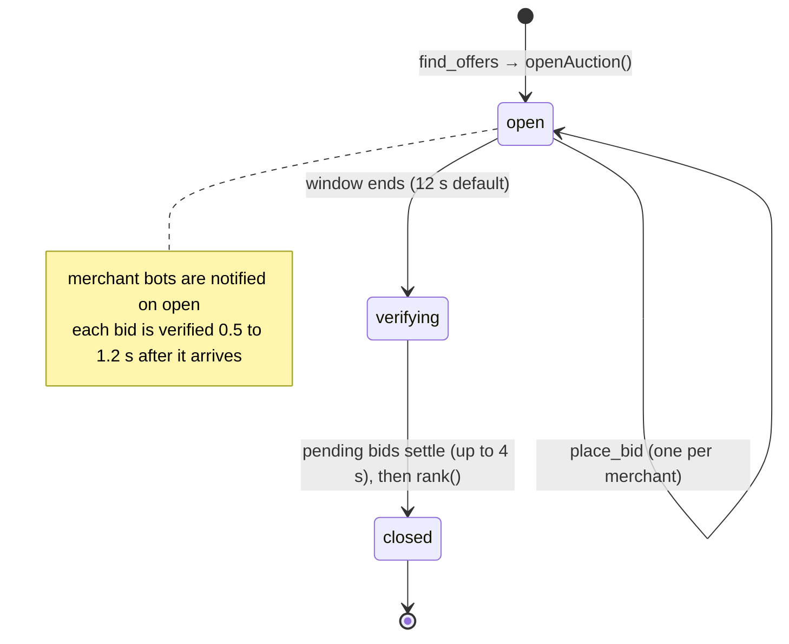
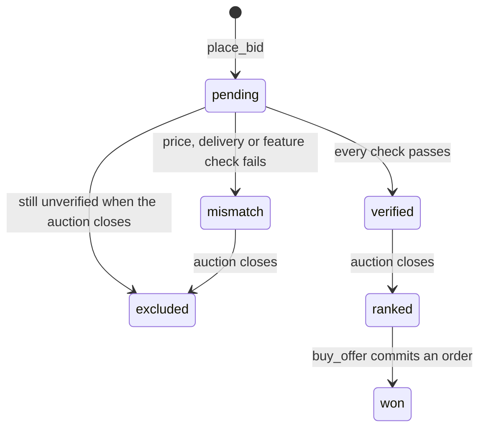
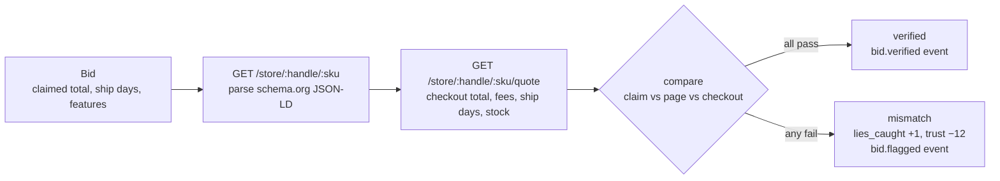
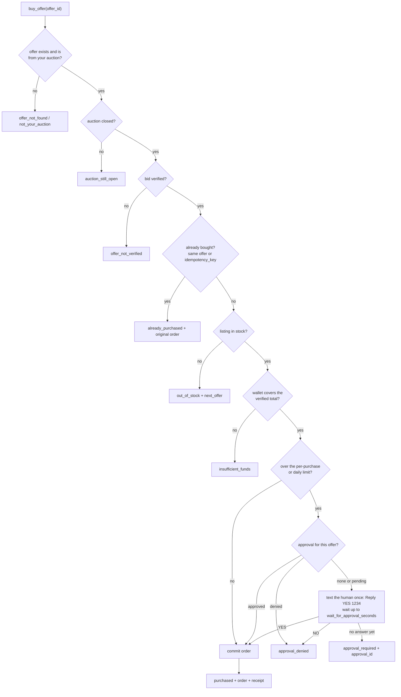
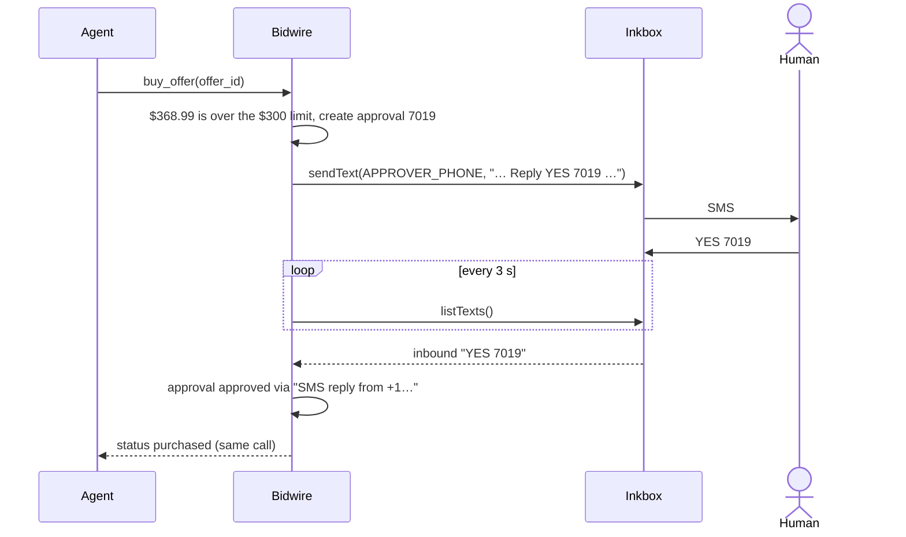

# Bidwire architecture

This is the deep dive behind the [README](../README.md): how a purchase moves through the system, what is stored where, the exact verification and ranking rules, how money is posted, which events the UI sees, and what the security model does and doesn't cover. Every rule here is taken from the code in `server/src`.

The web app speaks auction-house (a lot is an auction, a paddle is a bid, the hammer price is the winning verified total, commission is the merchant fee, "withdrawn: misrepresentation" is a bid that failed verification). This document uses the terms in the code.

- [The shape of the system](#the-shape-of-the-system)
- [Identity: who is calling](#identity-who-is-calling)
- [Data model](#data-model)
- [Auction lifecycle](#auction-lifecycle)
- [From need to auction](#from-need-to-auction)
- [Verification pipeline](#verification-pipeline)
- [Ranking](#ranking)
- [Buying, policy and approvals](#buying-policy-and-approvals)
- [Ledger posting rules](#ledger-posting-rules)
- [Trust](#trust)
- [Merchant bots](#merchant-bots)
- [Events (SSE)](#events-sse)
- [Security model](#security-model)
- [Extending Bidwire](#extending-bidwire)

## The shape of the system

Bidwire is one Node.js process (22.13+) built on [mcp-use](https://github.com/mcp-use/mcp-use)'s `MCPServer`, which runs on Hono. Everything is mounted on one port (8787 by default):

| Path | Served by | What it is |
| --- | --- | --- |
| `/mcp` | `mcp.ts` (mcp-use) | The MCP server: 12 tools, 3 resources, 2 prompts, streamable HTTP. |
| `/api/*` | `http.ts` | JSON API for the web app, the tools playground (`POST /api/tools/:name`) and the demo director. See [API.md](API.md). |
| `/api/stream` | `bus.ts` | Server-Sent Events: a full snapshot on connect, then every change. |
| `/store/:handle/:sku` | `storefront.ts` | A merchant's public product page with schema.org JSON-LD. |
| `/store/:handle/:sku/quote` | `storefront.ts` | The checkout quote: the real delivered total, fees included. |
| `/llms.txt` | `http.ts` | A plain-text summary of the server for agents. |
| everything else (GET) | `http.ts` | The built web app from `web/dist`, with an SPA fallback to `index.html`: `/` (landing), `/exchange` (the saleroom, also `/live`), `/merchant`, `/phone`, `/ledger`, `/connect`, `/director`. |

```text
server/src/index.ts
  ensureSeeded()        seed the catalog, merchants, buyers and opening balances if the DB is empty
  startBots()           subscribe the merchant bots to auction.opened
  resumeOpenAuctions()  re-arm close timers for auctions that were open when the process stopped
  mountHttp(server)     /api, /store, /llms.txt and the static web app
  initMessaging()       connect the Inkbox identity if INKBOX_API_KEY is set
  server.listen(PORT)
```

**One tool registry.** `tools.ts` defines each tool once (`name`, `title`, LLM-facing `description`, zod `input`, annotations, `handler`). `mcp.ts` registers those specs with mcp-use, the `/api/tools/:name` playground calls `callTool()` directly, and the built-in demo agent (`agent.ts`) calls `callTool()` too. All three paths validate with the same schema, run the same handler and write the same `tool_calls` log row, so the board shows a call from Claude Code, ChatGPT, the playground or the demo agent identically.

**State lives in rows, not memory.** Every auction, bid, approval, order and ledger entry is in SQLite (`node:sqlite`, WAL mode, foreign keys on). The only in-memory state is timers and waiters: close timers per auction, promises waiting for an auction to close or an approval to be decided, and a de-duplication map for in-flight verifications. After a restart, `resumeOpenAuctions()` re-arms the close timers.

## Identity: who is calling

Each MCP request resolves to a caller before the tool runs (`resolveCaller` in `mcp.ts`):

1. A key from `Authorization: Bearer <key>`, an `X-Bidwire-Key` header, or `?key=<key>`.
2. A buyer key (`bw_buy_…`) makes the caller that buyer agent. A merchant key (`bw_mer_…`) makes it that merchant. Merchant tools also accept `merchant_key` as an argument.
3. With no key, the client name from the MCP `initialize` handshake (or the user agent) decides: names containing `claude` shop as `b_claude`, `chatgpt`/`openai` as `b_chatgpt`, `codex` as `b_codex`, and everything else as the guest agent `b_guest`.

The client name is also normalized for display (`claude-code`, `claude`, `chatgpt`, `codex`, `cursor`, `mcp-inspector`, or the raw name) and stored on every auction and tool call.

## Data model

All money is integer cents. All timestamps are epoch milliseconds. Arrays and objects are stored as JSON text. The TypeScript view of these rows is in [`shared/types.ts`](../shared/types.ts).

| Table | Key columns | Notes |
| --- | --- | --- |
| `products` | `sku`, `title`, `brand`, `category`, `specs`, `features`, `msrp_cents` | 26 real products in 6 categories. `features` are normalized tags such as `anc`, `usb-c`, `65w`. |
| `merchants` | `id`, `name`, `handle` (unique), `kind` (`bot`, `human`, `agent`), `strategy`, `key` (unique), `trust`, `categories` | Running totals: `balance_cents`, `earned_cents`, `fees_paid_cents`, `bids`, `wins`, `lies_caught`. |
| `listings` | `merchant_id`, `sku`, `price_cents`, `shipping_cents`, `hidden_fee_cents`, `hidden_fee_label`, `ship_days`, `stock`, `returns_days` | The storefront truth. `hidden_fee_cents` only appears in the checkout quote (drip pricing). |
| `buyers` | `id`, `name`, `client`, `key` (unique), `human_name`, `phone`, `email`, `per_purchase_limit_cents`, `daily_limit_cents`, `wallet_cents`, `spent_today_cents` | The shopping agents and their humans' policy. |
| `auctions` | `buyer_id`, `client`, `need`, `category`, `must_have`, `budget_cents`, `deliver_within_days`, `status`, `opened_at`, `closes_at`, `closed_at`, `winner_bid_id` | `status`: `open` → `verifying` → `closed`. |
| `bids` | `auction_id`, `merchant_id`, `listing_id`, `claimed_price_cents`, `claimed_shipping_cents`, `claimed_ship_days`, `claimed_features`, `fee_cents`, `pitch`, `verify_status`, `evidence`, `merit`, `rank`, `why`, `bribe_ignored` | `UNIQUE(auction_id, merchant_id)`: one bid per merchant per auction. `verify_status`: `pending`, `verified`, `mismatch`. |
| `approvals` | `code` (4 digits), `buyer_id`, `auction_id`, `bid_id`, `amount_cents`, `limit_cents`, `reason`, `status`, `channel`, `decided_at`, `decided_via` | `status`: `pending`, `approved`, `denied`. `channel`: `inkbox` or `simulated`. |
| `orders` | `auction_id`, `bid_id` (unique), `buyer_id`, `merchant_id`, `sku`, `amount_cents`, `fee_cents`, `status`, `receipt_channel`, `idempotency_key` (unique) | One order per offer; one order per idempotency key. |
| `ledger` | `txn_id`, `order_id`, `account`, `delta_cents`, `memo` | Double-entry postings. Entries sharing a `txn_id` sum to zero. |
| `messages` | `channel` (`sms`, `email`), `direction`, `to_addr`, `from_addr`, `subject`, `body`, `related_id`, `provider`, `status`, `error` | Every text and email, real or simulated. Drives the on-screen phone. |
| `tool_calls` | `client`, `caller`, `role`, `tool`, `args`, `ok`, `summary`, `ms`, `tokens` | The audit trail of every tool call. `tokens` is the result size divided by four. |
| `trust_history` | `merchant_id`, `ts`, `trust`, `reason` | Every trust change with its reason. |
| `reports` | `bid_id`, `buyer_id`, `issue`, `outcome` | Agent reports and whether re-inspection confirmed them. |
| `settings` | `k`, `v` | `auction_ms` and `bots_enabled`, changeable live from the director. |

## Auction lifecycle



Each bid moves through its own states:



- `find_offers` opens the auction and waits for it to close (up to the window plus 8 s), then returns the ranked result. `get_offers` returns the same result for an auction you opened, waiting up to `wait_seconds`.
- Bids are rejected if the auction is not open or its window has passed (`auction_closed`), the listing isn't the merchant's (`listing_not_found`), the product is in another category (`wrong_category`), or the merchant already bid (`already_bid`).
- On close the auction moves to `verifying`, waits up to 4 seconds for in-flight verifications, ranks, and moves to `closed`. Bids still unverified are excluded with "could not be verified before the auction closed".
- The window comes from the `auction_ms` setting (default `AUCTION_MS`, 12000), clamped to 4–60 s when changed from the director.

## From need to auction

`parseNeed()` turns plain words into a category and must-have tags:

1. **Category.** Each category has trigger words (headphones: "headphone", "noise cancel", "earbuds", …; chargers: "charger", "gan", "power adapter", …). Words longer than four characters score 2, shorter ones 1; the best-scoring category wins. No match returns `unknown_category` with the supported categories in the hint.
2. **Must-haves.** Explicit `must_have` tags are normalized (`noise cancelling` → `anc`, `bluetooth` → `wireless`, `usbc` → `usb-c`). Tags are also inferred from synonyms in the need: "long flights" → `30h-battery`, "travel" → `travel`, "laptop" → `65w` for chargers.
3. **Feasibility.** Tags that no product in the category has are dropped, so an agent's free-form must-have can't make every offer fail.

"noise cancelling headphones for long flights" becomes category `headphones` with must-haves `anc` and `30h-battery`.

## Verification pipeline

Verification treats every bid as a claim about a storefront and checks it the way a careful shopper would, over HTTP:



The verifier fetches through the server's internal address (`http://127.0.0.1:$PORT`) and reports the public URL (`PUBLIC_URL`) in the evidence.

| Check | Rule | Example evidence |
| --- | --- | --- |
| Product page | the page has a JSON-LD `Offer` | `schema.org Offer found: $34.99 list price` |
| Checkout total | `claimed_total ≥ checkout_total − $0.50` | `Claimed $34.99 delivered; checkout says $63.99 (+$29.00 "Service & handling fee")` |
| Delivery time | `claimed_days ≥ store ship_days` | `Claimed 1d; store ships in 3d` |
| Features | every claimed feature is in the page's `additionalProperty` features | `Claims anc but the product page does not list it` |
| In stock | page availability is `InStock` and the quote says `in_stock` | `Out of stock at checkout` (not a lie; halves merit) |

The evidence (`VerifyEvidence`) is stored on the bid: page URL, fetch time, claimed vs actual total, claimed vs actual ship days, stock, each check with its detail, and a one-line summary. Agents get the summary in `excluded[]`, merchants get it from `get_my_results`, and anyone can see the full record with `explain_offer`.

What the agent sees and pays is always the **actual** checkout total from the evidence, never the claimed one. Overstating a price is not a lie (the check only fails on understatement), but it doesn't help either.

`report_offer` re-runs the same inspection on demand. A report is `confirmed` only if re-inspection finds a failing check, so reports can't be used to smear an honest merchant.

## Ranking

When an auction closes, `rank()` scores every verified bid. Let `T` be the verified delivered total, `T_min` the cheapest verified total among in-stock offers (or among all verified offers if none are in stock), `D` the buyer's deadline in days and `n` the offer's actual shipping days.

```math
\text{merit} = 100 \cdot \left( 0.40\,p + 0.25\,s + 0.15\,d + 0.15\,t + 0.05\,r \right) \cdot m_{\text{budget}} \cdot m_{\text{stock}}
```

| Term | Definition |
| --- | --- |
| price `p` | `T_min / T` |
| specs `s` | share of the auction's must-have tags the product has (1 when there are none) |
| delivery `d` | with a deadline: `1 − 0.3 · n / max(1, D)` if `n ≤ D`, otherwise 0; without one: `1 − min(n, 10) / 20` |
| trust `t` | merchant trust / 100 |
| returns `r` | `min(return days, 60) / 60` |
| `m_budget` | 0.85 if `T` is over budget, else 1 |
| `m_stock` | 0.5 if out of stock at checkout, else 1 |

Merit is rounded to one decimal. Every offer also gets plain-language reasons (`why`): price versus the cheapest, must-haves met or missing, delivery versus the deadline, trust and returns, over budget, out of stock, and the fee line.

**Worked example** (the `flight-headphones` run in the README hero: budget $400, deadline 5 days, must-haves `anc`, `30h-battery`, cheapest verified in-stock total $326.99):

| Offer | p | s | d | t | r | merit |
| --- | ---: | ---: | ---: | ---: | ---: | ---: |
| Parcel & Pine, $368.99, 1 day, 60-day returns, trust 91 | 0.886 | 1 | 0.94 | 0.91 | 1.0 | **93.2** |
| MegaMart Ads Co., $422.98, 5 days, 30-day returns, trust 71, over budget | 0.773 | 1 | 0.70 | 0.71 | 0.5 | 79.6 × 0.85 = **67.6** |

**Order and fees.** Offers are sorted by merit. The fee is only consulted when two offers are within 0.5 points of each other, in which case the higher fee goes first:

```ts
eligible.sort((x, y) => (Math.abs(y.merit - x.merit) >= 0.5 ? y.merit - x.merit : y.fee - x.fee));
```

Because the near-tie rule is pairwise, a chain of offers within 0.5 points of each other can come out in either order; offers further apart than that are always ordered by merit.

**Bribe ignored.** After sorting, an offer is flagged `bribe_ignored` when its fee is at least $10 and at least twice the fee of some offer ranked above it with at least 0.5 more merit. Its reasons then include `Offered $35.00/sale to the exchange; fees never buy rank, so it stays #5`. Every offer returned to an agent carries `fee_affected_rank: false`, and the fee is a cost per sale: it is only charged if the agent buys from that merchant.

## Buying, policy and approvals



- **Amount.** The charge is the verified checkout total from the evidence.
- **Limits.** Over the per-purchase limit, or `spent_today + amount` over the daily limit, needs approval. The approval stores the amount and the limit it exceeded (for the daily limit, the remaining allowance).
- **The text.** `Bidwire: your agent "<agent>" wants to buy <product> from <merchant> for $X (your limit is $Y). Reply YES 1234 to approve or NO 1234 to decline.` It is sent once per offer; a later `buy_offer` for the same offer reuses the pending approval.
- **Waiting.** `buy_offer` waits for the answer for `wait_for_approval_seconds` (default 40, max 55). An approval inside that window completes the purchase in the same call. Otherwise the agent gets `approval_required` and can wait with `check_approval` (default 25 s, max 55 s), then call `buy_offer` again.
- **Replies.** `^(yes|y|approve|ok|no|n|deny|decline)\b\D*(\d{4})?` (case-insensitive). The 4-digit code selects the approval; without one, the reply applies to the most recent pending approval. Real SMS replies and the on-screen phone go through the same parser.
- **Channels.** If an Inkbox identity is connected and the buyer has a phone number, the text goes out with `sendText` (idempotency key `<approval id>-sms`) and replies are found by polling `listTexts` every 3 seconds. Otherwise the approval is `simulated` and appears on `/phone`. The web app can also decide an approval directly with `POST /api/approvals/:id/decide`.



**Sold out.** If the listing's stock is zero, `buy_offer` returns `out_of_stock` with `next_offer`: the best-ranked verified offer from the same auction whose listing still has stock. The `sell-out` scenario simulates a rival buying the #1 merchant's last unit to show the recovery.

**Receipts.** After the order commits, a receipt email goes out (Inkbox if configured and the buyer has an email, otherwise the simulated inbox) without blocking the purchase; `receipt_channel` is updated when it's sent.

## Ledger posting rules

Accounts:

| Account | Meaning |
| --- | --- |
| `funding:<buyer>` | where a wallet's prepaid money came from (the owner's top-up) |
| `buyer:<buyer>:wallet` | the agent's prepaid wallet |
| `merchant:<merchant>:revenue` | what the merchant earned, net of fees |
| `platform:fees` | Bidwire's fees per sale |

Postings:

| Event | Transaction | Debit (−) | Credit (+) |
| --- | --- | --- | --- |
| Seed | one funding transaction for all wallets | `funding:<buyer>` −wallet | `buyer:<buyer>:wallet` +wallet |
| Purchase | sale | `buyer:<buyer>:wallet` −amount | `merchant:<merchant>:revenue` +amount |
| Purchase with a fee | fee | `merchant:<merchant>:revenue` −fee | `platform:fees` +fee |

A purchase runs in one SQLite transaction (`BEGIN IMMEDIATE`): insert the order, post the sale and fee transactions, then update the running totals (buyer wallet and spend today, merchant earned/fees/balance/wins), decrement stock and set the auction's winner. Either all of it lands or none of it does. Afterwards the merchant gains 1 trust point and `order.created`, `ledger.posted`, `buyer.updated` and `merchant.updated` events go out.

Invariants:

- Every transaction's postings sum to zero, so all accounts together always sum to zero. `npm test` checks this over the ledger.
- `orders.bid_id` and `orders.idempotency_key` are unique, and `buy_offer` returns the existing order before attempting a new one, so retries can't double-charge.
- Amounts are integer cents end to end.

## Trust

Trust is a 0–99 score per merchant, recorded in `trust_history` with a reason:

| Event | Change |
| --- | ---: |
| Seeded bot | starts at 71–91 |
| New store (human or agent) | starts at 75 |
| Verifier catches a lie | −12 |
| Agent report confirmed by re-inspection | −10 |
| Completed verified sale | +1 |

Trust is 15% of merit, so a merchant caught lying keeps losing ground on every future auction, for every agent on the exchange.

## Merchant bots

`bots.ts` subscribes to `auction.opened`. Each bot whose categories include the auction's category bids once after a persona-specific delay (scaled down for windows shorter than 12 s and always before the close):

| Strategy | Delay | Fee (cap) | How it picks and claims |
| --- | --- | --- | --- |
| briber | 0.7–1.4 s | $35 (25% of price) | Bids first with the biggest fee. Honest claims. |
| drip-pricing-liar | 1.3–2.6 s | $12 (8%) | Claims the price without its hidden checkout fee. |
| spec-stretcher | 1.8–3.6 s | $10 (8%) | Bids its cheapest item and claims every must-have. |
| specialist | 1.5–4.2 s | $6 (8%) | Honest. |
| honest-value | 2.0–4.8 s | $5 (8%) | Honest. |
| scarce-stock | 2.4–5.0 s | $5 (8%) | Honest, one unit per listing. |
| premium-fast | 2.6–5.2 s | $8 (8%) | Honest, next-day delivery. |
| slow-shipper | 3.2–6.0 s | $3 (8%) | Honest, 9-day shipping. |

Bots only bid in-stock listings. Every bot except the spec-stretcher picks the listing that matches the most must-haves and is closest to 80% of the budget; any bot skips the auction if its pick costs more than 1.6× the budget. Fees have a $1 floor. Bots can be switched off from the director (`POST /api/demo/bots`).

## Events (SSE)

`GET /api/stream` sends `data: {"type", "ts", "data"}` messages, `retry: 1500`, and a comment ping every 15 seconds.

| Event | Payload | When |
| --- | --- | --- |
| `hello` | `Snapshot` | on connect |
| `auction.opened` | `Auction` | an agent calls `find_offers` |
| `bid.placed` | `Bid` | a bid arrives (pending) |
| `bid.verified` | `Bid` | the verifier passes a bid |
| `bid.flagged` | `Bid` | the verifier catches a lie |
| `auction.closed` | `Auction` | the auction is ranked and closed |
| `approval.requested` | `Approval` | a purchase needs the human |
| `approval.decided` | `Approval` | the human approves or declines |
| `order.created` | `Order` | a purchase commits |
| `order.failed` | `{ auction_id, bid_id, reason }` | a merchant sold out (or a demo rival bought the last unit) |
| `merchant.joined` | `Merchant` | a store opens |
| `merchant.updated` | `Merchant` | trust or totals change |
| `buyer.updated` | `Buyer` | a wallet changes |
| `message` | `Message` | a text or email is sent or received |
| `tool.call` | `ToolCall` | any tool call, from any client |
| `ledger.posted` | `LedgerEntry[]` | an order's postings |
| `stats` | `Stats` | after changes (debounced 120 ms) |
| `demo.reset` | `Snapshot` | the director re-seeds |
| `config` | `Snapshot["config"]` | the auction window or bots setting changes |

The snapshot holds the 20 most recent auctions (with bids), all merchants and buyers, and recent orders, approvals, messages and tool calls.

## Security model

What the design enforces:

- **Claims are never trusted.** Ranking and charging use the verified checkout total. Bids that understate the total, overstate delivery speed or invent features are excluded with evidence.
- **Fees can't buy rank.** A fee only orders near-ties (under 0.5 merit points) and is charged only on a sale.
- **Agents are scoped.** A buyer can only fetch and buy from its own auctions and only check its own approvals and orders (`not_your_auction`, `approval_not_found`, `order_not_found`). `explain_offer` is deliberately public: verification evidence is meant to be inspectable. Merchant tools require a merchant key; merchants can only bid their own listings, once per auction, in the right category, while the auction is open.
- **Money moves only through `buy_offer`.** The server enforces the wallet balance and the per-purchase and daily limits; over a limit, nothing is charged until the human says yes. Orders are idempotent and committed atomically.
- **Reports can't be weaponized.** A report only costs trust if re-inspection reproduces the problem.
- **Secrets stay out of logs.** `merchant_key` arguments are redacted in the tool-call log.

What this hackathon build does **not** protect, and what to do before a real deployment:

| Gap | Why it matters | Fix |
| --- | --- | --- |
| Demo buyer keys are public (seeded, shown on `/connect`) and no key means the guest agent. | Anyone who can reach the server can shop with the demo wallets. | Per-user keys or OAuth; no default identity. |
| `/api/demo/*`, `POST /api/approvals/:id/decide` and `POST /api/phone/reply` have no authentication. | Anyone who can reach the API can reset the exchange or approve a pending purchase. | Authenticate operators; bind approvals to the human's channel (signed links, verified sender number). |
| `/api/state` and `/api/stream` are public and include buyer contact fields (`phone`, `email`), the message log and every tool call. | A public deployment with real `APPROVER_PHONE`/`RECEIPT_EMAIL` exposes them. | Redact contact fields; authenticate the board or serve a public subset. |
| mcp-use serves on `0.0.0.0` without Host validation (it logs a warning). | DNS rebinding against a locally running server. | Set `allowedHosts` or bind to `127.0.0.1` locally. |
| The verifier only fetches Bidwire-hosted storefronts. | Crawling real stores introduces SSRF and cloaking risks. | Allow-list hosts, block private ranges, re-verify at purchase time from varied vantage points. |
| `spent_today_cents` never resets. | The "daily" limit is really a running total until reset. | Reset per calendar day in the human's time zone. |

## Extending Bidwire

- **A tool:** add a `ToolSpec` to `TOOLS` in `server/src/tools.ts`. It is exposed over MCP, in the playground and to the demo agent automatically. Throw `BidwireError(code, message, hint)` for agent-actionable errors, and add a line to `summarize()` so the board shows a useful one-line result.
- **A category or product:** add products to `PRODUCTS` and a category (trigger words and feature synonyms) to `CATEGORIES` in `server/src/catalog.ts`, then re-seed with `POST /api/demo/reset`.
- **A merchant strategy:** add a persona to `PERSONAS` and its delay, fee and pitch to `bots.ts`; implement its behavior in `botBid()`.
- **A verification check:** add it to `inspectStorefront()` in `server/src/exchange.ts`. Any failing check other than "In stock" marks the bid as a lie.
- **An event:** add it to `BidwireEvent` in `shared/types.ts` and `emit()` it; the web app receives it over `/api/stream`.
